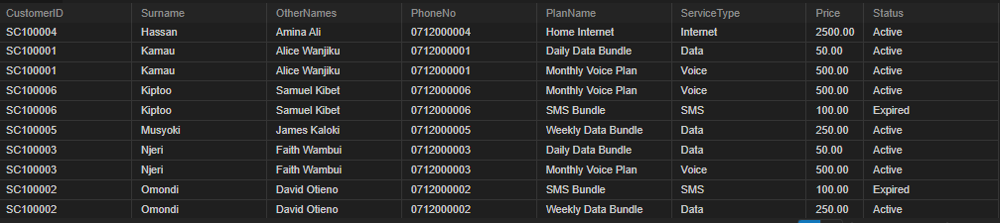

# Safaricom PLC Database Management System

A relational database project developed using **MySQL** to demonstrate the management of telecommunications customers, employees, service plans, subscriptions, and customer service interactions.

This academic project is inspired by Safaricom PLC, one of Kenya's leading telecommunications companies. It demonstrates practical database design, relational modelling, SQL queries, and reporting.

## Project Overview

The database provides a structured way to manage information relating to:

- Service centres and their locations.
- Employee records and job descriptions.
- Employee contact information.
- Customer records and phone numbers.
- Telecommunications service plans.
- Customer subscriptions.
- Customer service interactions handled by employees.

The project focuses on applying database management concepts to a telecommunications business environment.

## Technologies Used

- **Database:** MySQL
- **Database Management Tool:** MySQL Workbench
- **Query Language:** SQL
- **Version Control:** Git and GitHub

## Database Structure

The database is named `safaricom_management` and consists of nine relational tables.

| Table | Description |
|---|---|
| `SERVICE_CENTRE` | Stores service centre details and locations. |
| `JOB_DESCRIPTION` | Stores employee job titles and salary information. |
| `EMPLOYEE` | Stores employee personal and employment details. |
| `EMPL_PHONE` | Stores employee phone numbers. |
| `CUSTOMER` | Stores customer registration information. |
| `CUST_PHONE` | Stores customer phone numbers. |
| `SERVICE_PLAN` | Stores available telecommunications plans and prices. |
| `SUBSCRIPTION` | Records customer subscriptions to service plans. |
| `CUST_EMPL` | Records customer service interactions handled by employees. |

## Key Features

- Relational database design using primary and foreign keys.
- Customer and employee information management.
- Multiple phone numbers associated with customers and employees.
- Telecommunications service plan management.
- Customer subscription tracking.
- Employee-customer service interaction records.
- SQL queries for retrieving and analysing business information.

## SQL Reports

The project includes three main SQL reports:

**1. Customer Subscriptions Report**

Displays customer details, phone numbers, subscribed service plans, subscription dates, and subscription statuses.

**2. Employee Service Report**

Shows employees and the number of customer service interactions handled by each employee.

**3. Active Subscriptions Summary**

Summarises active customer subscriptions and the total listed prices of their associated service plans.

## Project Screenshots

### Database Tables


### Customer Subscriptions Report


### Employee Service Report


### Active Subscriptions Report

## Project Files

```text
Safaricom-PLC-Database/
│
├── README.md
│
├── safaricom_management_backup.sql
│
├── docs/
│   └── Safaricom_PLC_Database_Design.docx
│
├── screenshots/
│   ├── database_tables.png
│   ├── customer_subscriptions.png
│   ├── employee_service_report.png
│   └── active_subscriptions_report.png
│
└── .gitignore
```

## How to Install and Run

1. Install MySQL Server and MySQL Workbench.
2. Clone or download this repository.
3. Open MySQL Workbench and connect to your local MySQL server.
4. Import the database backup:

   - Select **Server → Data Import**.
   - Choose **Import from Self-Contained File**.
   - Browse to `safaricom_management_backup.sql`.
   - Start the import.

5. Refresh the Schemas panel.
6. Select the `safaricom_management` database and execute your SQL queries.

Alternatively, the backup can be restored using the MySQL command line.

## Learning Outcomes

Through this project, I gained practical experience in:

- Database design and relational modelling.
- Creating tables and defining relationships.
- Implementing primary and foreign key constraints.
- Writing SQL `CREATE`, `INSERT`, `SELECT`, and `JOIN` statements.
- Generating reports using aggregate functions such as `COUNT()` and `SUM()`.
- Managing and backing up MySQL databases.
- Using MySQL Workbench for database administration.

## Disclaimer

This is an academic database project inspired by Safaricom PLC. It is not affiliated with, endorsed by, or an official database of Safaricom PLC.

All sample customer, employee, subscription, and service records are fictional and intended for educational purposes.

## Author

**Daniela Wakhu**

Computer Science Student | Aspiring Software Developer

GitHub: [@DannyAI05](https://github.com/DannyAI05)
